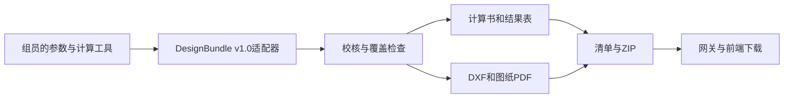

# 小组接口交接说明

## 调用流程



上游完成计算后构造同一份 `DesignBundle`，先调用 `validate_bundle` 或 `/api/v1/validate`。严重错误修正后再生成。覆盖缺项与来源不足仍可生成草稿，前端必须保留标识。

## HTTP约定

所有 POST 请求：

```json
{
  "bundle": {"schema_version": "1.0", "其余字段": "详见examples与JSON Schema"},
  "options": {"include_pdf": true, "include_dwg": false, "office_timeout_s": 120}
}
```

上方仅展示外层结构，不能直接作为有效工程输入。可直接发送 `examples/demo.json` 内容作为 `bundle`。

| 接口 | 行为 |
|---|---|
| POST `/api/v1/validate` | 返回输入校核和覆盖检查，不写文件 |
| POST `/api/v1/calculation-books` | DOCX、同源PDF和XLSX，附审计记录和ZIP |
| POST `/api/v1/design-files` | DXF、图纸PDF及可选DWG，附审计记录和ZIP |
| POST `/api/v1/packages` | 一次生成完整成果 |
| GET `/api/v1/runs/{run_id}` | 获取已完成运行的元数据，重启后仍可读取 |
| GET `/api/v1/runs/{run_id}/files/{artifact_id}` | 只下载已登记且完整性校验通过的文件 |

生成请求为同步请求。小组网关的读取超时应留出文档转换时间，建议至少360秒；浏览器显示生成中，不连续重复提交。每次调用都生成新运行编号。若用户中止等待，服务端运行可能仍会完成；首版未提供任务取消或异步队列。

成功处理的请求返回 HTTP200，`generation_status=partial/failed` 时仍需显示错误和可用文件。结构/契约错误返回422；下载不存在返回404；已生成文件被修改导致哈希不符返回409。

所有 `artifacts[].url` 都是相对服务地址；前端按网关基址拼接，不用本机绝对路径。SDK/CLI 返回的 `output_dir` 供本地使用，HTTP 不暴露该路径。HTTP 不接收输出路径、转换器路径或任意命令。

## Python与LangChain

```python
from steelmind_export import generate_calculation_book, generate_design_files

book = generate_calculation_book(bundle, {}, "runs")
drawings = generate_design_files(bundle, {}, "runs")
```

一次性完整成果建议调用 `generate_package`，避免两个独立运行目录混淆版本。若调用两个工具，使用同一输入快照，并比较 `normalized_sha256`。

```python
# 仅工作流组需要：pip install 'steelmind-export[langchain]'
from steelmind_export.adapters import make_langchain_tools
book_tool, drawing_tool = make_langchain_tools("runs")
result = book_tool.invoke({"bundle": bundle, "options": {"include_pdf": True}})
```

LangChain适配器返回的下载URL只有在成果目录与网关配置的根目录相同时才可访问。也可用 HTTP 工具调用本服务，由网关统一管理文件。

## 字段映射检查表

| 上游内容 | 目标字段 | 交接要求 |
|---|---|---|
| Excel或前端参数 | `project`, `model` | 节点/杆件/截面/材料ID稳定；不根据显示名关联 |
| 荷载及组合工具 | `load_cases`, `combinations` | 荷载方向、单位、系数及来源完整 |
| OpenSeesPy结果 | `analysis` | 全局/局部坐标、端力作用方向、释放、组合ID先转换 |
| 钢构件验算 | `checks` | 输入实际需求与限值、比较方向、公式代入和依据，不只给布尔值 |
| 计算过程 | `traces` | 原始数值、单位、来源及有效JSON定位 |
| 运行记录 | `provenance` | 工具版本、数据性质、上游run_id、来源 |

参考 `docs/design-bundle.schema.json` 查看全部必填字段、枚举与数值类型。未知字段会被拒绝；请在上游适配，不要把未建模的偏心、刚域等字段丢弃后假装模型等价。

## 责任与联调验收

| 责任方 | 交付给下一方的内容 |
|---|---|
| 参数组 | 模板字段、单位、材料及荷载数据来源 |
| 计算组 | 模型、全套计算结果、适用规范及验算覆盖；确认端力符号 |
| 本成果模块 | 契约、校核、计算书/图纸/表格、文件清单及下载接口 |
| 工作流组 | 缺项追问、计算调用、结果快照、失败处理和工具调用日志 |
| 前端组 | 独立显示三种状态、草稿/FAIL、警告、下载列表 |
| 案例验证负责人 | 使用实际计算结果替换演示数据，记录人工或独立程序对照 |

联调按顺序完成：最小几何输入 → 演示FAIL输入 → 解析基准 → 小组真实案例。教学覆盖清单 `steel-frame-teaching-v1` 是数据交接清单，需由计算负责人复核适用范围；不是完整规范验算清单。

取消草稿标识还要求每个组合覆盖所有节点位移、所有杆件端力和约束支座反力，并提供上游来源、运行编号和工具版本。沿程采样可选；同一杆件/组合/位置不能把 `single` 与 `left/right` 混用。示例和解析基准始终保留其数据性质标识。

请勿将演示案例中的数值、来源标签或公式当作规范参数。最终课程说明书和案例验证报告需要包含组员实际计算与独立复核的证据，本模块的文件映射测试不能替代该证据。
